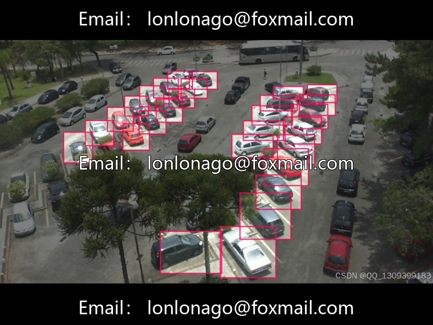
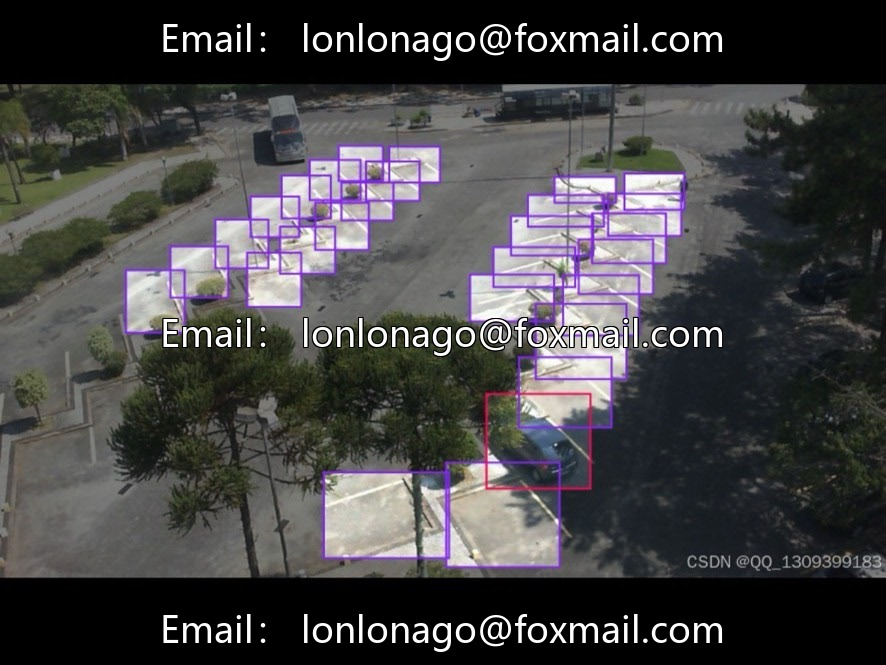
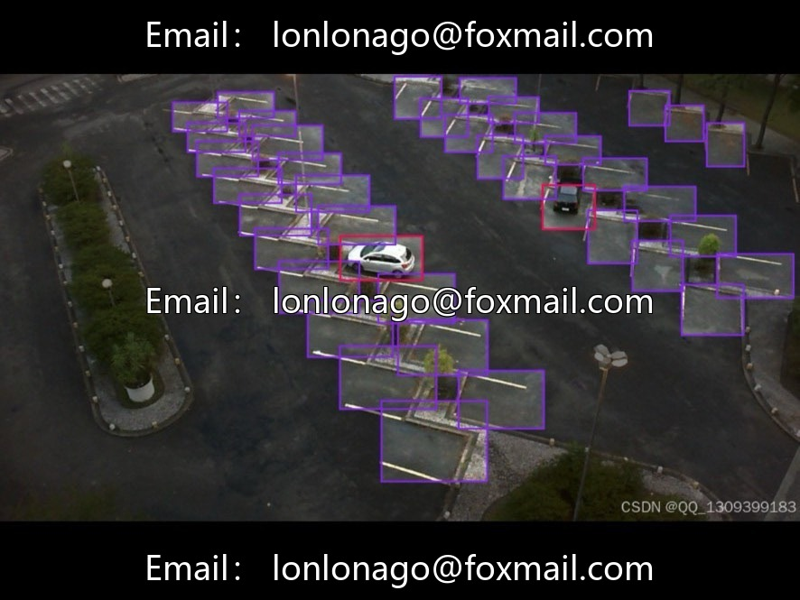
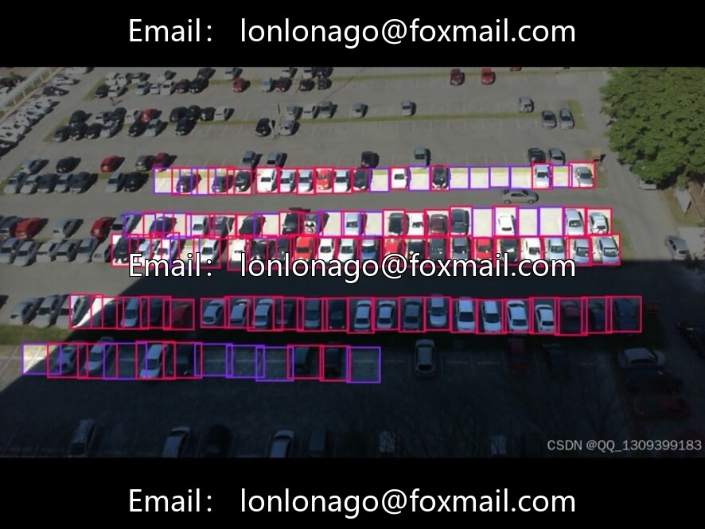
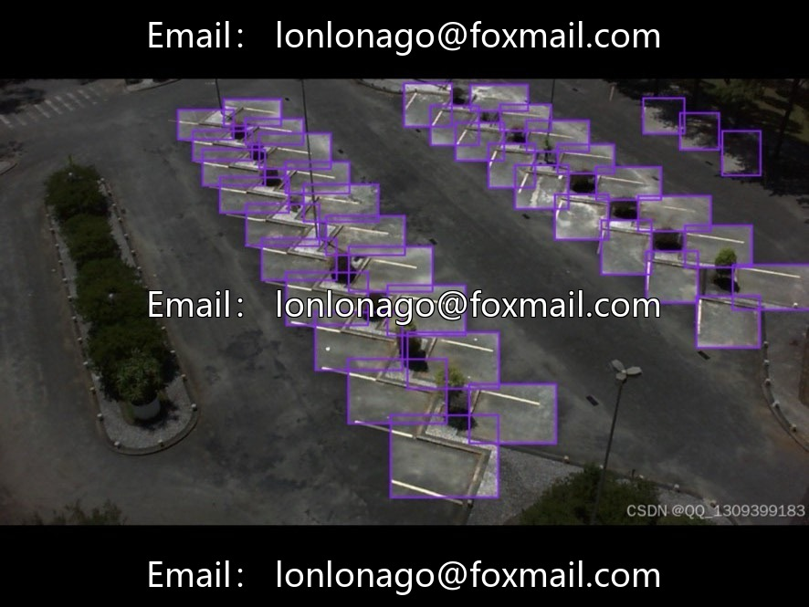

# High-altitude aerial parking lot detection dataset | Issue 10038

## Body

High-altitude aerial parking lot detection dataset | Issue 10038
Total 7959 aerial images, 8K medium size, covering various lighting and real scenes of parking lots at different times, suitable for training models on parking lot occupancy detection.

The dataset contains 4 categories of annotations.
1. Occupied / Space-Occupied: The occupied parking space for parked vehicles.
2. Space-Empty / Unoccupied: The unoccupied parking space with no vehicles.
The two categories essentially have the same meaning, differing only in naming; both represent the state of a parking space being occupied or unoccupied. Combining and simplifying training would be beneficial.

Officially, no fixed split is provided; industry-standard 7:2:1 allocation: 70% training set, 20% validation set, and 10% test set, respectively used for feature learning, hyperparameter tuning to prevent overfitting, and generalization performance testing.

Mainstream image resolutions are 640×480 and 1280×720, taking into account both parking lot contour recognition and computational power consumption.

Suitable for scenarios such as real-time monitoring of available parking spaces in smart parking lots, urban traffic flow statistics, automatic parking, autonomous driving visual perception module training, and urban smart travel platforms.

Virtual materials, once sold, are non-refundable.
Interested friends, click "I want" to proceed.

## Images

## Payment

Here is a pay link on Stripe ( https://buy.stripe.com/3cs8yP7sY87d0vu9AB ). Please contact me lonlonago@foxmail.com after funding $89, and I will send you a complete data files , thank you!

